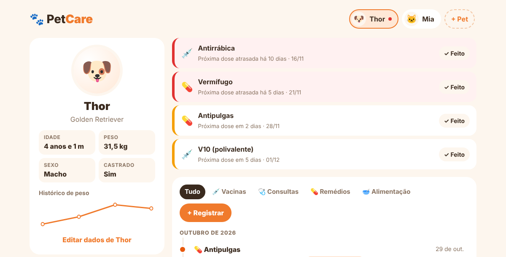

# PetCare — Cuidados com pets

Controle de vacinas, consultas, remédios e alimentação dos pets, com alertas de datas que estão chegando ou atrasadas.

🔗 **[Ver o site no ar](https://iamviniciuslima05.github.io/PROJETO-PetCare/)**



## Funcionalidades

- **Vários pets** com espécie, raça, idade, peso, sexo e castração
- **Vacinas, consultas, remédios e alimentação**
- **Alertas** do que vence em até 7 dias e do que está atrasado
- Botão **Feito** que já agenda a próxima dose no mesmo intervalo
- **Linha do tempo** por mês com filtro por categoria
- **Histórico de peso** em gráfico
- Dosagem, frequência, veterinário e valor da consulta

## Tecnologias

HTML5 · CSS3 · JavaScript · SVG · localStorage

## Estrutura

```
index.html
css/style.css
js/script.js
```

## Como rodar

Não precisa instalar nada: baixe o projeto e abra o `index.html` no navegador, ou acesse a versão publicada acima.

---
Feito por **Vinicius Lima** · [Portfólio](https://viniciuslimadev.netlify.app) · [LinkedIn](https://www.linkedin.com/in/viniciuslima25/)
